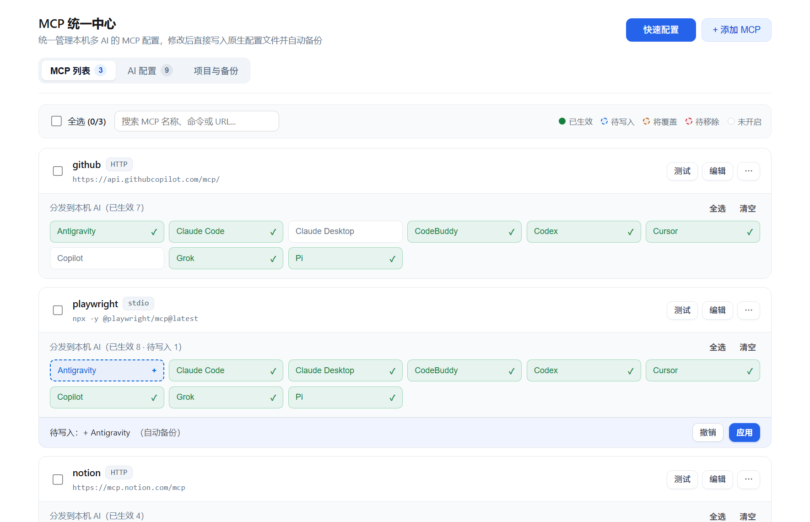

<div align="center">
  
  <h1>MCP Sync Hub（MCP 统一中心）</h1>
  <p>
    <strong>为 CodexHost Desktop &amp; Web 打造的跨 AI 统一 MCP 管理、多账户 OAuth 授权与实时配置同步中心</strong>
  </p>
  <p>
    <a href="https://github.com/ErkundenSie/codexhost-mcp-hub/releases/latest">
      
    </a>
    
    
    <a href="LICENSE">
      
    </a>
  </p>
</div>

---

**MCP Sync Hub** 让你在一个界面里集中管理本机所有 AI 客户端的 **Model Context Protocol (MCP)** 配置：支持自动扫描 **24 个内置 AI 配置目标**（100% 覆盖 CodexHost 全部 20 个 Harness + VS Code / Claude Desktop / Gemini CLI / DeepSeek Web）、内置 OAuth 2.1 浏览器统一登录与多账户隔离、实时文件监听自动同步、HTTP/SSE 工具列表发现以及安全增量写入与自动备份。

> **原生持久化**：所有变更直接写入各家 AI 自己的原生配置文件（`.toml` / `.json` / `.yml` / `.yaml`）。即使关闭或卸载 CodexHost，你的 MCP 配置依然完整生效。



## ✨ 核心特性

- **🔍 自动扫描 24 个内置 AI 目标（100% 覆盖 CodexHost Harness + VS Code）**
  自动识别已安装的 AI 客户端配置文件（兼容 TOML、DeepSeek Cordis YAML、Hermes YAML、VS Code JSONC、ZCode JSON、Standard JSON、Antigravity JSON、Copilot JSON、OpenCode JSON），支持查看原始配置文件、自定义路径与添加自定义 JSON 目标。
- **🔐 内置 MCP OAuth 2.1 授权与多账户隔离**
  - 纯 Node 原生实现 RFC 9728 / RFC 8414 / RFC 7591 动态注册与 PKCE S256 浏览器授权；
  - 首次导入/加载时自动识别需要鉴权（HTTP 401）的远程 MCP 并持久化缓存，后续打开零重复网络请求；
  - 登录成功后弹窗选择要写入的 AI，或保留为「仅在本页使用」；支持**后台自动续期**并静默回写到已同步的 AI；
  - 支持同一 MCP URL 下的**同名多账户聚合单卡**（例如 AI A 用账号 A、AI B/C 用账号 B、AI D 走原生登录），各账户令牌与续期完全隔离。
- **🔄 实时文件监听自动同步**
  监听本机 AI 配置文件保存事件（750ms 防抖 + 自写回环抑制），支持 **双向同步 / 主源单向**、**仅更新已有该 MCP / 广播到全部已选 AI**、按指定 MCP 过滤、语法损坏与整文件清空熔断保护，以及持久化同步日志。
- **🧪 连通性探测与工具列表发现**
  - **Streamable HTTP（JSON / SSE）**：握手探测并拉取 `tools/list`，在卡片内可折叠查看全部工具名与说明；
  - **stdio**：校验本地可执行文件与参数中引用的本地脚本路径。
- **⚡ 快速配置向导 & 卡片即时应用**
  支持顶部两步式「快速配置」批量下发/移除（带同名不同配置覆盖保护），也支持单卡片内即时勾选、撤销与一键应用。
- **🛡️ 安全增量写入 + 自动备份回滚**
  - Codex / Grok TOML、DeepSeek Cordis YAML 与 Hermes YAML 均采用块级局部更新，保留原文件注释、模型、无关插件块与单服务扩展字段；VS Code JSONC 自动保留 `inputs`、`sandbox`、`gallery`、`version` 等元数据；Copilot CLI 自动保留已有的 `tools` 白名单；
  - 自动排除并保护官方内置 MCP（如 Codex `node_repl`）与指向本机 CodexHost（`127.0.0.1:4398/mcp`）的回环 MCP；
  - 每次写入前自动保存带时间戳的原文件备份（最多保留 40 份），支持随时一键恢复。
- **📁 项目级 MCP 同步**
  一键扫描并写入项目目录内的 `.mcp.json`、`.cursor/mcp.json`、`.codex/config.toml`、`opencode.json`、`.vscode/mcp.json`。

## 🤖 支持的 AI 客户端

除以下 **24 个内置 AI 配置目标**（100% 覆盖 CodexHost 全部 20 个 Harness + VS Code 及独立客户端/Profile）外，还支持在 **AI 配置** 页添加任意自定义 JSON 目标：

| AI 客户端 | 配置格式 | 默认配置文件路径 |
| --- | --- | --- |
| **Codex** | `codex-toml` (`mcp_servers`) | `~/.codex/config.toml` |
| **Grok** | `codex-toml` (`mcp_servers`) | `~/.grok/config.toml` |
| **DeepSeek Desktop** | `dsh-cordis-yaml` (`mcp-manager` / `dsh-mcp-client`) | `~/.dsh/profiles/desktop/cordis.patch.yml` |
| **DeepSeek Web** | `dsh-cordis-yaml` (`mcp-manager` / `dsh-mcp-client`) | `~/.dsh/profiles/web/cordis.patch.yml` |
| **Hermes** | `hermes-yaml` (`mcp_servers`) | `~/.hermes/config.yaml` |
| **Pi** | `standard-json` (`mcpServers`) | `~/.pi/agent/mcp.json` |
| **Oh My Pi (`omp`)** | `standard-json` (`mcpServers`) | `~/.omp/agent/mcp.json` |
| **Claude Code** | `standard-json` (`mcpServers`) | `~/.claude.json` |
| **Claude Desktop** | `standard-json` (`mcpServers`) | Windows: `%APPDATA%\Claude\claude_desktop_config.json`<br/>macOS: `~/Library/Application Support/Claude/claude_desktop_config.json`<br/>Linux: `~/.config/Claude/claude_desktop_config.json` |
| **Antigravity (`agy`)** | `antigravity-json` (`mcpServers`) | `~/.gemini/config/mcp_config.json` |
| **Cursor / Cursor CLI** | `standard-json` (`mcpServers`) | `~/.cursor/mcp.json` |
| **GitHub Copilot CLI** | `copilot-json` (`mcpServers`) | `~/.copilot/mcp-config.json` |
| **VS Code** | `vscode-json` (`servers`, JSONC) | Windows: `%APPDATA%\Code\User\mcp.json`<br/>macOS: `~/Library/Application Support/Code/User/mcp.json`<br/>Linux: `~/.config/Code/User/mcp.json` |
| **CodeBuddy** | `standard-json` (`mcpServers`) | `~/.codebuddy/mcp.json` |
| **OpenCode** | `opencode-json` (`mcp`) | `~/.config/opencode/opencode.json` |
| **ZCode** | `zcode-json` (`mcp.servers`) | `~/.zcode/cli/config.json` |
| **Devin CLI** | `standard-json` (`mcpServers`) | Windows: `%APPDATA%\devin\mcp_config.json`<br/>macOS / Linux: `~/.config/devin/mcp_config.json` |
| **Qwen Code** | `standard-json` (`mcpServers`) | `~/.qwen/settings.json` |
| **Gemini CLI** | `standard-json` (`mcpServers`) | `~/.gemini/settings.json` |
| **Kiro CLI** | `standard-json` (`mcpServers`) | `~/.kiro/settings/mcp.json` |
| **Kimi Code** | `standard-json` (`mcpServers`) | `~/.kimi/mcp.json` |
| **WorkBuddy** | `standard-json` (`mcpServers`) | `~/.workbuddy/mcp.json` |
| **Qoder** | `standard-json` (`mcpServers`) | `~/.qoder/settings.json` |
| **Qoder CN** | `standard-json` (`mcpServers`) | `~/.qoder-cn/settings.json` |

## 🚀 安装方式

### 方式一：CodexHost 插件市场一键安装（推荐）

本插件已上架 CodexHost 官方扩展市场：
1. 打开 CodexHost Desktop 或 Web，进入 **插件中心 → 市场**；
2. 搜索 **`MCP 统一中心`** 或 **`MCP Sync Hub`**，点击安装并启用。

### 方式二：通过 GitHub 仓库导入

1. 在 CodexHost **插件中心** 点击右上角 **导入插件 → GitHub**；
2. 填入仓库地址：`ErkundenSie/codexhost-mcp-hub`（其余可选项留空，自动拉取最新 Release）；
3. 安装完成后启用即可使用。

### 方式三：本地 `.zip` 包导入

1. 从 [Releases](https://github.com/ErkundenSie/codexhost-mcp-hub/releases/latest) 下载最新的 `mcp-sync-hub-*.zip`；
2. 在 CodexHost **插件中心** 点击 **导入插件 → 本地 .zip** 上传安装。

## ⚙️ 插件设置

在 CodexHost **插件中心 → MCP 统一中心 → 插件设置** 中可随时调整：

| 设置项 | 默认值 | 说明 |
| --- | --- | --- |
| **启用实时自动同步** (`enableAutoSync`) | `开启` | 允许后台监听本机 AI 配置文件变化并按策略自动同步；关闭时暂停后台监听，「自动同步」标签页与历史配置仍保留显示。 |
| **启用内置 OAuth 登录按钮** (`enableBuiltinOAuth`) | `开启` | 为需要认证的 HTTP/SSE 远程 MCP 显示「登录」按钮，支持浏览器 PKCE 统一授权、后台自动续期、工具探测与多账户隔离。 |

> 自动备份（写入前备份）、官方内置 MCP 保护、CodexHost 回环防套娃保护以及 4000ms 探测超时均已在后台默认启用，无需繁琐配置。

## 🔒 安全与隐私设计

- **零外部依赖 & 零子进程**：全部使用 Node.js 原生内置模块，不调用 `child_process`、`eval` 或 `new Function`，完整通过插件市场静态安全扫描。
- **令牌私有隔离**：OAuth 令牌按卡片 ID 独立存储在插件私有目录 `oauth-tokens.json`（POSIX 权限 `0600`），原始 `access_token` / `refresh_token` 绝不通过 `overview` 接口暴露给前端。
- **原子写入与全格式熔断保护**：全部文件写入采用临时文件原子替换（`atomicWriteText`），兼容 UTF-8 BOM；自动同步按目标 AI 合并为单次备份 + 单次写入，并内置「整文件清空熔断」与 TOML / YAML / JSON / JSONC「语法错误熔断」，防止误操作扩散。

## 🛠️ 本地开发与测试

需要 Node.js 20+（无需 `npm install`，零外部依赖）：

```bash
# 运行全部自动化测试（含 ZIP CRC、TOML/YAML 局部更新、Auto-Sync、OAuth 2.1 PKCE 多账户隔离）
node --test test/hub.test.mjs

# 打包为 CodexHost 可导入的 .zip（输出至 dist/mcp-sync-hub-<version>.zip）
node scripts/pack.mjs
```

<details>
<summary>📂 目录结构</summary>

```text
codexhost-mcp-hub/
├── manifest.json                 # CodexHost manifestVersion: 2 插件清单
├── CHANGELOG.md                  # 版本更新日志（GitHub Release 自动提取来源）
├── assets/
│   ├── icon.png                  # 插件图标 (256x256 PNG)
│   └── preview.png               # 界面预览图
├── shared/
│   ├── i18n.mjs                  # 中英文 1:1 双语字典
│   └── models.mjs                # MCP 规范化、JSON 解析、内置/回环识别与指纹对比
├── page/
│   ├── index.mjs                 # Desktop + Web 页面入口 (mount) 与状态协调
│   ├── dom.mjs                   # 轻量 DOM/SVG 构建工具
│   ├── modals.mjs                # 快速配置、添加/编辑/多账户、OAuth 确认与写入弹窗
│   ├── tabs/
│   │   ├── servers.mjs           # MCP 列表（同名多账户聚合单卡 + 折叠工具面板）
│   │   ├── targets.mjs           # AI 配置（自动检测 + 原文查看 + 自定义路径/目标）
│   │   ├── autosync.mjs          # 实时自动同步策略与持久化日志
│   │   └── project-backups.mjs   # 项目级配置同步与自动备份恢复
│   └── style.css                 # 主题适配样式（自动跟随浅色 / 深色模式）
├── backend/
│   ├── index.mjs                 # 单实例 Node 后端入口 (activate) 与全部 RPC
│   ├── adapters.mjs              # 24 个内置 AI 目标 + 自定义目标 + 项目级格式适配器
│   ├── dsh-yaml.mjs              # DeepSeek Cordis YAML 注释与插件块保留型局部更新器
│   ├── hermes-yaml.mjs           # Hermes config.yaml `mcp_servers` 局部更新器
│   ├── oauth.mjs                 # 纯 Node MCP OAuth 2.1（PKCE + 自动续期 + 多账户隔离）
│   ├── probe.mjs                 # Streamable HTTP (JSON/SSE) 工具发现与 stdio 路径探测
│   ├── watcher.mjs               # 父目录级 fs.watch 防抖监听与自写抑制器
│   ├── toml.mjs                  # Codex / Grok TOML 注释保留型局部更新器
│   └── store.mjs                 # 中心库持久化、authHints 缓存、日志与备份管理
├── scripts/
│   ├── generate-assets.mjs       # 纯 Node PNG 资源生成脚本
│   └── pack.mjs                  # 纯 Node ZIP 打包器（CRC32 + Deflate）
└── test/
    └── hub.test.mjs              # 完整单元测试与端到端回归测试套件
```

</details>

## 📝 更新日志

完整版本变更记录请查看 [CHANGELOG.md](CHANGELOG.md) 或 [GitHub Releases](https://github.com/ErkundenSie/codexhost-mcp-hub/releases)。

## 📄 License

[MIT](LICENSE)
